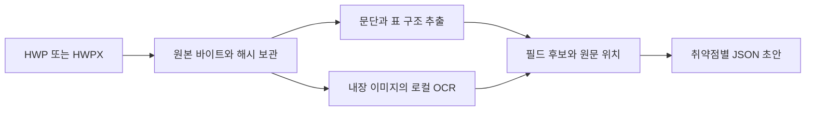
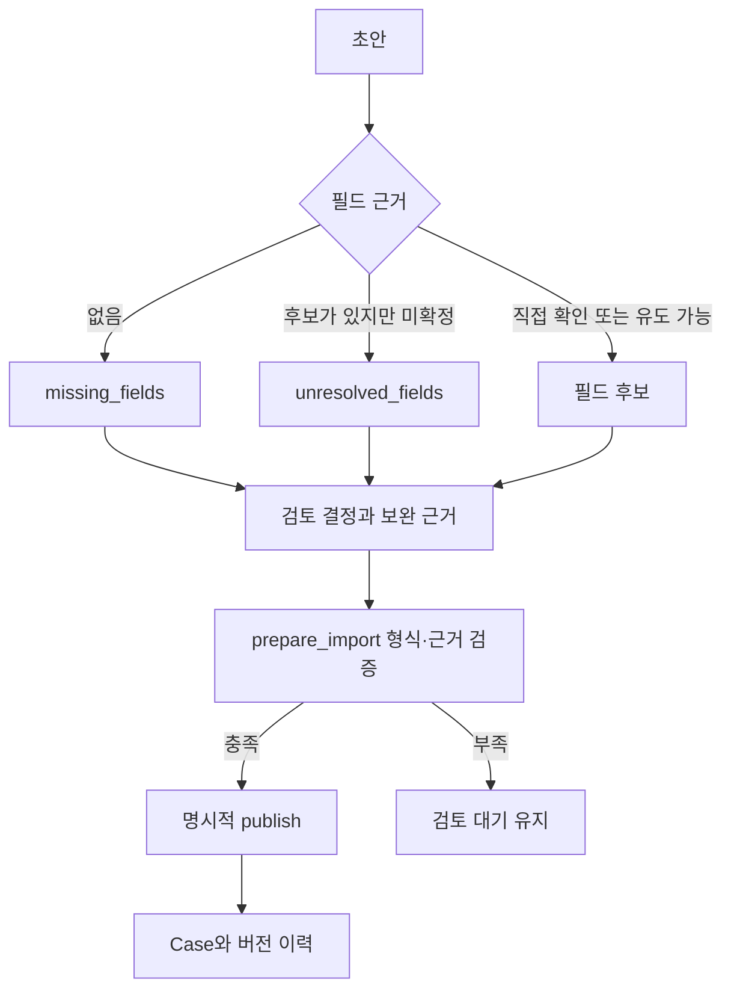
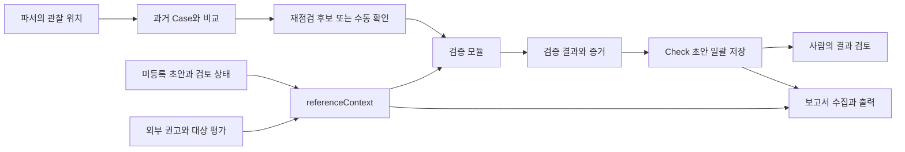
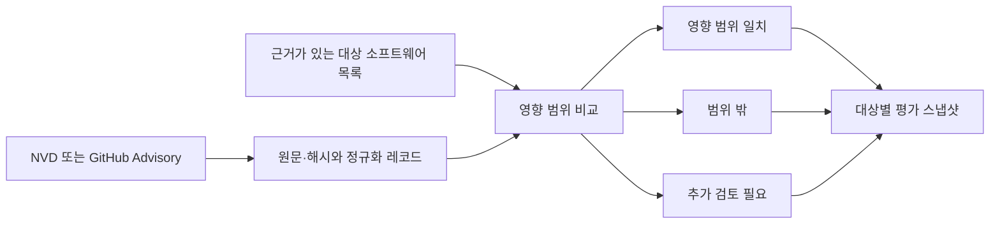

# 보고서 기반 DB 처리와 모듈 연결

## 문서 접수와 후보 추출

`ReportIntake.stage`가 원본·초안을 접수한다. HWPX는 압축 내부 XML, HWP v5는 별도 리더 워커 결과를 공통 구조로 변환한다. `build_report_draft`는 표 레이블과 명시적 항목명 문단을 매핑한다. `apply_narrative_analysis`는 관련 문장을 사전 조건·절차·관찰 결과로 분류한다. OCR 원출력은 `apply_ocr_evidence`에서 미검토 후보로 연결한다.

원본과 후보는 다른 기록이다. 문서 전체 바이트는 intake에 보존하고 JSON에는 필드별 원문 위치와 표현을 남긴다. 위치에서 유도한 경로·입력 이름도 원래 URL과 분리한다. payload의 원문과 인코딩 표기·디코딩 참고값을 합쳐서 덮어쓰지 않는다.

## 검토와 등록

검토 기록은 원본 초안 해시에 연결된다. 보완값에는 이유와 해당 사례의 근거 참조를 요구한다. 없는 값을 가정해 필수 필드를 통과시키지 않는다. 입력이 적용되지 않는 유형은 명시적 미적용 검토와 이유가 있을 때만 면제한다.

기본 등록은 전체 항목이 준비되지 않으면 보류한다. `ready_only`를 명시하면 준비된 항목만 등록하며 나머지 상태를 보존한다. Case 배치는 트랜잭션으로 저장하고 재실행은 같은 내용을 중복 등록하지 않는다. Case DB와 접수 DB 간 영수증은 재실행으로 복구한다.

## 조회·재점검·보고서 연결

위치 일치는 현재 취약점 판정이 아니다. 검증 모듈의 실제 결과가 있어야 Check가 생기며 참고한 Case 버전을 고정한다. 증거 해시는 파일 바이트의 일관성을 확인한다. 결과 자체의 의미를 증명하거나 검토를 대신하지 않는다.

미등록 초안도 `referenceContext`로 전달한다. 후보·미확인 필드·보완값·등록 상태가 이후 모듈에서 빠지지 않도록 수집 자료에 보존하고, 보고서 출력에 그대로 표시한다. 모델이 작성한 문장에 빠져 있어도 보존된 검토 맥락을 렌더링한다.

## 공개 취약점 정보

원천 권고와 대상 평가는 별도 기록이다. 원천이나 목록이 바뀌면 과거 평가의 최신 여부를 구분한다. 버전 비교 결과로 재현 성공·실행 권한을 생성하지 않는다. 자세한 문법은 [APPLICABILITY.md](APPLICABILITY.md)에 있다.

## 팀 환경에서 확인할 사항

로컬 기능과 별도로 실제 파서의 선택적 입력 위치, 검증기의 결과 계약, 실행 저장소·접수 작업 공간 경로, 보고서 수집 설정을 팀 환경에서 맞춘다. 운영자가 대상 허가 범위, 계정 권한, 자료 접근·보관·폐기, DB 동시 쓰기 요구, 백업·복구와 DB 이전 시점을 정한다.
