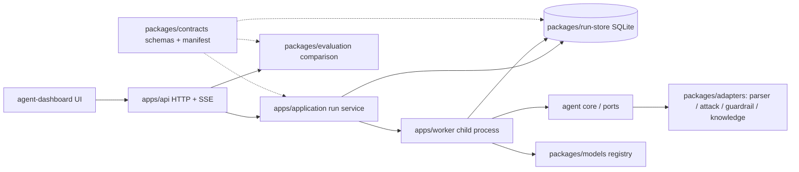

# CA3P 모듈 경계

| 계층 | 역할 | 주요 검증 |
| --- | --- | --- |
| contracts | schema/version, run identity, secret redaction, module provenance | 모든 계약 소비자 및 전체 루프 |
| agent core | 관찰·계획·행동·검증·판정 실행 순서 | agent unit, 고정 결과 회귀 |
| adapters | 브라우저·curl·정책·과거 사례 및 카탈로그 변환; UI에서 실행 구현 분리 | 모듈 unit + adapter 통합 + 실제 실습 |
| models | 등록된 모델 선택, 설정·입출력 metadata | 가짜 provider 성공·실패·취소, 규칙 기반 실제 루프 |
| application/worker | 시작·중지·상태 및 프로세스 분리 | 수명주기, 재시작·실패·취소 |
| run-store | 이벤트·run·model-call 기록 | SQLite 재조회·중복·복구 |
| evaluation | 모듈·모델·결과 차이 계산 | 기준/후보 호환성 및 구조화 diff |
| API/UI | 인증, 조회·실행·비교, SSE와 화면 | HTTP 권한, state 계약, UI render |

과거 사례 일치와 카탈로그는 참고 자료다. 취약점 확인은 같은 실행의 요청·응답 및 독립 브라우저 증거를 사용한다. 모델 계획과 결정론적 finding 판정을 분리한다. 다른 SHA·모듈 hash의 차이를 원인으로 확정하지 않고 변경과 관측을 함께 표시한다.

불변 run manifest에는 소스 revision, 모듈 digest, 계약·ruleset·카탈로그·fixture digest, 모델·prompt 설정이 필요하다. 입력 fixture·환경이 다른 결과는 동등한 조건의 실험과 구분한다. 실제 모델 호출은 고정 입력과 반복 시험으로 별도 평가하고 통합 게이트는 모델 대역과 규칙 baseline으로 코드 회귀를 판단한다.
