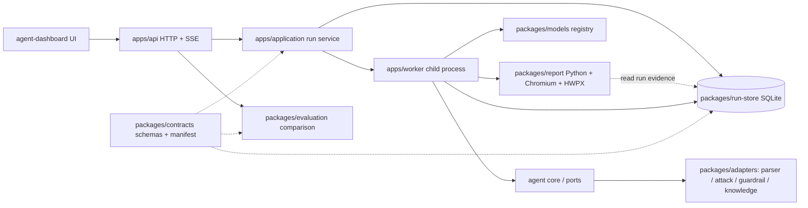

# CA3P 모듈 경계

| 계층 | 역할 | 주요 검증 |
| --- | --- | --- |
| contracts | schema/version, run identity, secret redaction, module provenance | 모든 계약 소비자 및 전체 루프 |
| agent core | 관찰·계획·행동·검증·판정 실행 순서 | agent unit, 고정 결과 회귀 |
| adapters | 브라우저·curl·정책·과거 사례 및 카탈로그 변환; UI에서 실행 구현 분리 | 모듈 unit + adapter 통합 + 실제 실습 |
| models | 등록된 모델 선택, 설정·입출력 metadata | 가짜 provider 성공·실패·취소, 규칙 기반 실제 루프 |
| application/worker | 시작·중지·상태 및 프로세스 분리 | 수명주기, 재시작·실패·취소 |
| run-store | 이벤트·run·model-call 기록 | SQLite 재조회·중복·복구 |
| evaluation | 모듈·모델·결과 차이 계산 | 기준/후보 호환성 및 구조화 diff |
| report | 최종 검사 자료 수집·촬영·문서 작성, HWPX 바이너리 artifact | 가짜 모델의 실제 HWPX 작성, 취소·실패 분리, 인증 다운로드 |
| API/UI | 인증, 조회·실행·비교, SSE와 화면 | HTTP 권한, state 계약, UI render |

과거 사례 일치와 카탈로그는 참고 자료다. 취약점 확인은 같은 실행의 요청·응답 및 독립 브라우저 증거를 사용한다. 모델 계획과 결정론적 finding 판정을 분리한다. 다른 SHA·모듈 hash의 차이를 원인으로 확정하지 않고 변경과 관측을 함께 표시한다.

불변 run manifest에는 소스 revision, 모듈 digest, 계약·ruleset·카탈로그·fixture digest, 모델·prompt 설정이 필요하다. 입력 fixture·환경이 다른 결과는 동등한 조건의 실험과 구분한다. 실제 모델 호출은 고정 입력과 반복 시험으로 별도 평가하고 통합 게이트는 모델 대역과 규칙 baseline으로 코드 회귀를 판단한다.

실제 실습의 코어 결과를 저장한 뒤 worker가 보고서 Agent를 실행한다. 촬영할 게시판과 작업 lease는 작성 완료·실패·취소까지 유지한 후 정리한다. `run.report`는 검사 결과이며 `run.reportDocument`는 별도의 생성 상태다. 문서 실패로 finding을 덮어쓰지 않는다. HWPX는 JSON 마스킹 경로와 분리된 불변 바이너리 artifact로 저장하고, 로그인한 사용자의 전용 다운로드 API에서 run 연결과 크기·해시를 확인한다.

## 통합 취약점 DB

`pentest-db`는 교체된 모듈이며 독립 카탈로그·DB·수명주기를 갖지 않는다. `casper-db`의 한 SQLite 파일이 CERT 사례, 공개 권고, 공격 정보·payload·검증 규칙 및 미래 템플릿 계약을 관리한다. 새 Agent 호출은 `casper-db`를 사용한다. 실행 registry는 `run-store`, 기존 파일 아티팩트는 `run-evidence` 어댑터가 보존한다. 예전 이름은 이력 읽기와 호환 별칭에만 남는다. 공격 툴은 통합 DB의 패턴 revision·검증 규칙·executor 계약을 소비한다.
