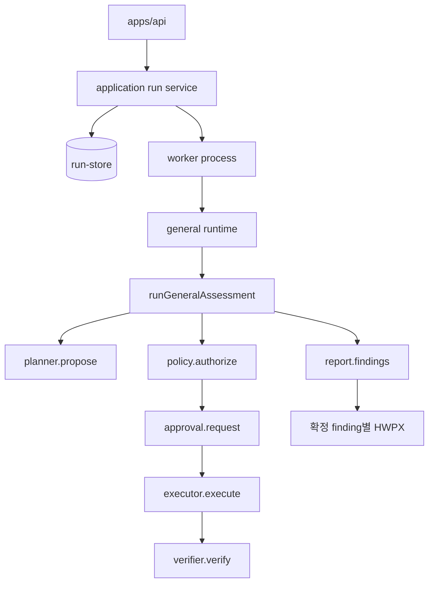
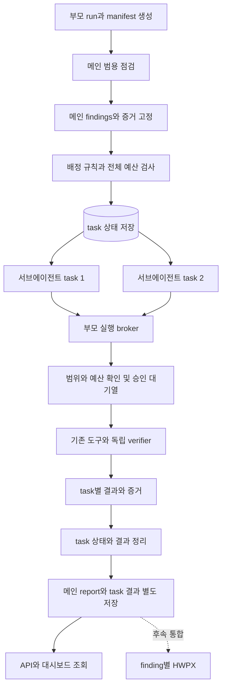

# Finding 기반 멀티 에이전트 실행 계획

현재 범용 점검을 메인 에이전트로 사용하고, 메인이 만든 finding을 작업 단위로 배정받는 서브에이전트 실행 계층을 추가한다. 첫 구현은 메인 점검 종료 후 서브에이전트를 실행하는 방식으로 한다. 각 서브에이전트는 독립된 플래너와 판단 문맥을 갖고 후속 검사를 수행한다.

분석 기준은 `1mn2147/agent/sub_runtime`의 `de4544b`다. 분석 시 로컬 HEAD와 `origin/develop`은 같았다. 아래 설계 목표 가운데 이번에 구현한 범위와 후속 범위를 구분한다.

## 현재 구현과 보고서 통합 보류

`local-lab-general`의 opt-in `multiAgent` 설정을 추가했다. 메인 report의 최종 findings 중 후속 검사가 가능한 항목을 최대 4개 배정하고, 같은 worker 안에서 최대 2개 독립 플래너를 실행한다. 각 자식은 원본 가설·증거로 시작하며 배정된 경로 또는 파일에 읽기 검사만 할 수 있다. 승인 요청은 부모의 단일 대기열을 순서대로 사용한다. task 상태와 결과는 부모 lease 아래 별도 SQLite 테이블에 저장하며, API와 대시보드에서 조회한다. 기존 단일 에이전트 요청 경로는 그대로 유지한다.

**보고서 모듈과의 통합은 이번 변경에서 보류한다.** `packages/report`는 수정하지 않는다. 멀티 에이전트 실행의 `run.report`에는 메인 결과만 유지하고, 자식 결과는 `run.multiAgent` 요약과 `run_subtasks` 상세 결과로 분리한다. 이 실행의 HWPX 생성은 `MULTI_AGENT_REPORT_DEFERRED`로 표시한다. 취소되거나 최종 report가 없는 실행은 기존 중단·결과 없음 상태로 표시한다. 단일 에이전트 실행의 HWPX 경로는 유지한다.

현재 총 probe 수는 기본 24개를 메인 16개·자식 최대 8개로 예약한다. 자식 하나당 최대 2개 probe와 2회 판단 반복을 허용한다. 자식의 실제 HTTP 요청 수, verifier 요청 수, 모델 토큰, 전체 경과 시간에 대한 부모 단위 계측과 제한은 다음 단계에서 추가한다. 자식은 현재 `http_get` 또는 해당 파일의 `repository_read`만 사용하며, 템플릿 finding·승인 거절·정책 차단 항목은 배정하지 않는다.

## 현재 실행 구조

| 영역 | 코드에서 확인한 상태 | 확장 시 필요한 사항 |
| --- | --- | --- |
| 판단 코어 | `agent/src/general-assessment.js`의 `runGeneralAssessment()`가 observe → plan → policy → approval → execute → verify를 반복한다. probe는 순차 실행한다. | finding을 입력으로 받는 후속 판단 문맥과 작업 범위 제한이 필요하다. |
| findings | `buildFindings()`가 반복 종료 시와 최종 종료 시 결과를 갱신한다. 현재 이벤트에는 finding snapshot 전달 계약이 없다. | 첫 단계는 최종 결과를 배정 기준으로 사용한다. 반복 중 배정은 후속 확장으로 둔다. |
| 플래너 | `general-model-planner.js`는 새 가설·probe를 제안하고, 독립 검증기가 판정한다. `packages/models/local-planner.mjs`가 DeepSeek·로컬·등록 API 모델을 연결한다. | 서브에이전트별 플래너 인스턴스와 제한된 문맥을 생성한다. 모델별 새 통신 구현은 만들지 않는다. |
| 도구 통신 | `packages/adapters/integrations/attack-tool.mjs`가 category별 principal과 client를 만들고 두 포트를 사용한다. | 이 client는 독립 에이전트가 아니다. task/agent별 실행 추적과 서버 측 권한 바인딩을 추가한다. |
| 로컬 런타임 | `general-runtime.mjs` 내부에 관측·세션·policy·executor·verifier·필수 템플릿 실행이 함께 묶여 있다. | 실행 환경 수명주기와 각 판단 루프의 수명주기를 분리해야 한다. |
| worker | `worker.mjs`는 `busy`, `activeLease`, `runtime` 하나로 한 번에 한 run을 처리한다. | 부모 run 내부의 task pool을 둔다. 서브 작업을 기존 최상위 jobs에 넣으면 현재 worker가 부모를 기다리는 동안 자식 작업을 처리하지 못한다. |
| 저장·복구 | `run-store`가 run lease·heartbeat·action intent·이벤트 순서를 관리한다. lease 만료 시 interrupted 처리하고 자동 재개하지 않는다. | task 저장과 결과 반영에도 부모 lease를 검사한다. 중단된 변경 요청은 재전송하지 않는다. |
| 승인 | `hitl-approval.js`는 run당 대기 한 건만 허용한다. API와 worker도 단일 `pendingApproval`을 전제로 한다. | 부모의 승인 broker가 여러 task 요청을 대기열에 넣고 한 건씩 승인 화면에 게시한다. |
| 결과 소비 | worker는 최종 `run.report.findings`에서 확정 항목별 보고서를 만들고, history·API·UI도 이 결과를 읽는다. | 모든 task를 정리하고 집계를 저장한 뒤 기존 후처리를 실행한다. |
| 보고서 수집 | Python 수집기는 최종 `general-assessment/1` 보고서와 저장된 Agent `verify` 이벤트를 대조한다. `run-store`의 SQLite `user_version=1`만 읽는다. | task 결과만 따로 저장해서는 확정 finding의 HWPX를 만들 수 없다. 최종 보고서·이벤트·검증 handoff를 함께 맞추고 DB 버전 변경을 조정한다. |

코어의 현재 기본 예산은 반복 6회·probe 24개·증거 128개이며 상한은 각각 32·128·256이다. 이를 서브에이전트마다 그대로 부여하면 실행 비용과 요청 수가 자식 수에 비례해 늘어난다.

### 선행 정리가 필요한 계약 차이

1. `agent/README.md`는 finding을 가설별로 유지한다고 설명하지만, 실제 `buildFindings()`는 verifier가 template identity를 반환하면 `category + asset`으로 병합하고 `finding:t-<digest>`를 만든다. template identity가 없으면 `finding:<hypothesisId>`를 유지한다. 기존 테스트도 이 구분을 검증한다. task는 최종 finding ID만 저장하지 말고 원본 hypothesisIds와 증거 snapshot을 함께 고정해야 한다.
2. `category + asset`은 파라미터·권한 경계·검증 규칙을 구별하지 못한다. 첫 구현은 원본 finding과 그 provenance를 보존하고 새로운 자동 중복 병합을 추가하지 않는다. 정확한 위치와 검증 규칙이 필요한 통합은 별도 identity 계약으로 다룬다.
3. `run-request.schema.json`은 external 모델을 `rule-baseline`으로 제한하지만 실제 run service는 범용 모델을 요구한다. 로컬·등록 API 모델도 런타임 지원과 스키마 열거가 일치하지 않는다. 멀티 에이전트 옵션을 추가할 때 실제 서비스 검증과 공통 요청 스키마를 정렬하고 회귀 검증한다.
4. 과거 계획 문서에는 이미 삭제된 `orchestrator.js`와 단일 검사 유지 설명이 남아 있다. 새 구현은 현재 범용 코어를 확장하며 폐기된 실행기를 복원하지 않는다.

### 보고서 모듈과 병행 변경할 때 유지할 접점

현재 `packages/report`는 저장된 최종 run에서 보고서 하나당 `confirmed` finding 하나를 선택한다. 선택 항목의 `id`는 유일해야 하고, `hypothesisId` 또는 `hypothesisIds`에 해당하는 가설이 최종 `run.report.hypotheses`에 있어야 한다. 모든 probe·evidence ID도 최종 report 안에서 유일해야 한다. 서브에이전트의 결과를 합칠 때 이 조건을 먼저 확인한다.

Python 수집기는 `run.report`의 `schemaVersion: general-assessment/1`, `assessmentMode: general`, 부모 `runId`, 최종 `status: completed | failed`를 확인한다. 범용 이벤트는 최종 `state_json.events`에서 `source: agent/general-assessment`, `module: agent`인 항목만 읽는다. 따라서 서브의 확정 결과는 별도 task report에만 두지 않고, 같은 최종 report의 가설·probe·evidence와 부모 이벤트의 `verify` 기록에 연결해야 한다. `verify.request.hypothesisId`·`probeId`, `verify.response.status`·`evidenceIds`가 서로 일치하고, 확정 증거에는 해당 probe가 이번에 수집한 증거가 하나 이상 포함돼야 한다. 과거 참고 자료만으로 만든 확정 결과는 문서 수집 단계에서 거부된다.

worker의 현재 `verificationDirFor()`는 finding의 대표 `hypothesisId`에 연결된 첫 확정 probe의 `<verificationRoot>/<probeId>/verification.json`을 선택한다. 서브의 검증 산출물을 사용할 때에는 최종 확정에 채택한 probe와 handoff 경로를 명시적으로 매핑한다. handoff의 `result.attackId`는 선택 finding의 확정 probe ID와 같아야 하며 이미지 크기·해시 검사도 유지한다. 여러 서브 probe 중 아무 디렉터리나 고르면 다른 증거가 보고서에 붙을 수 있다.

`run-store`에 task 테이블을 추가하면서 SQLite `user_version`을 올리면 현재 Python 수집기가 run을 거부한다. 버전을 유지할 수 있는 추가 스키마인지 검토하고, 버전 변경이 필요하면 보고서 수집기의 지원 버전과 통합 테스트를 같은 변경 단위에서 갱신한다. 보고서 모듈에서 이 계약을 수정하는 작업이 병행되면 위 입력·출력 조건과 테스트를 구현 시점의 코드에 다시 대조한다. 보고서 모듈의 문서 작성 로직과 수집 형식 변경은 이 접점 검증을 통해 통합한다.

## 첫 구현 범위

`local-lab-general`에 opt-in 옵션을 추가한다. 기존 요청은 단일 에이전트로 실행하고, 서버가 검증한 멀티 에이전트 설정은 run manifest에 고정한다. 등록된 세 실습 대상의 기존 범위·모델 선택·승인 정책을 따른다.

메인 에이전트는 현재와 같이 탐색과 검증을 마친다. coordinator는 최종 findings를 보고 추가 검증할 항목을 결정하고, 제한된 수의 서브에이전트에 배정한다. 서브에이전트는 원본 finding, 연결된 관측 자료, 가설과 증거, 허용 도구와 예산만 받아 같은 대상을 후속 검사한다.

첫 구현에서는 같은 worker 프로세스 안에서 서로 다른 플래너 인스턴스를 비동기 task pool로 실행한다. 각 task의 판단 상태와 결과를 분리한다. 별도 OS 프로세스가 필요한 경우 coordinator의 실행 포트를 교체할 수 있게 하되, 최초 단계에서 프로세스별 lease·IPC·자격 증명 전달까지 도입하지 않는다.

| 메인 finding 상태 | 기본 배정 규칙 |
| --- | --- |
| `inconclusive` | 지원 도구로 추가 증거를 얻을 수 있으면 우선 배정한다. |
| `not_tested` | 미점검 사유가 예산 또는 순서 때문이고 실행 가능한 도구가 있으면 배정한다. 정책 거부·미지원 도구는 배정으로 우회하지 않는다. |
| `confirmed` | 추가 대조·재현이 가능한 항목에 한해 후속 순위로 배정한다. 새 결과는 별도 검증 기록으로 남긴다. |
| `not_reproduced` | 이번 자동 재검사에서 제외한다. |

기본값 제안은 동시 서브에이전트 2개·최대 task 4개·위임 깊이 1이다. task는 추가 task를 생성하지 않는다. 배정 가능한 finding이 없으면 서브 호출 없이 메인 결과로 끝낸다. 위 수치는 구현 시 설정 검증과 테스트로 고정할 초깃값이다.

외부 대상 `external-general`은 두 번째 적용 범위다. 현재 외부 런타임은 `http_get`·`http_compare`와 원점·경로·요청 수·시간 제한을 갖는다. 로컬 검증 후 이 별도 정책을 유지한 채 연결한다. 브라우저 실행 확인이나 새로운 취약점 도구 추가는 별도 작업으로 둔다.

## 목표 실행 흐름

### 역할과 모듈 경계

- **agent 코어**는 주입된 초기 문맥에서 판단 루프를 수행한다. 메인과 서브의 planner prompt를 구분하고, 서브가 받은 finding의 후속 검사라는 목적을 명시한다. 코어에 DB·프로세스·대상 HTTP 구현을 넣지 않는다.
- **application coordinator**는 배정, 동시 실행 수, 전체 예산, 승인 대기열, 대상 변경 직렬화와 집계를 관리한다. 모델이 실행 범위나 자격 증명을 지정할 수 없도록 서버가 고정한다.
- **worker**는 부모 lease와 heartbeat, 취소·종료·후처리를 책임진다. task 결과가 저장되기 전에는 부모 run을 terminal로 공개하지 않는다.
- **run-store**는 task 수명주기와 배정 중복 방지, 부모 lease에 따른 결과 반영을 담당한다. 최종 run 상태의 작성자는 coordinator를 통하는 부모 worker 하나로 둔다.
- **adapters**는 기존 도구 통신을 제공한다. category별 권한 구분에 task 추적 정보를 더하되, 모델이 보낸 agentId를 실행 권한으로 사용하지 않는다.

### 실행 환경 분리

`general-runtime.mjs`에서 fixture 준비·세션 bootstrap·관측 snapshot·도구 생성·종료를 담당하는 실행 환경을 추출한다. 메인과 서브는 이 환경에서 제한된 포트를 받는다. 서브마다 `createGeneralRuntime()`을 새로 호출해 같은 대상 재초기화·로그인·전체 필수 템플릿 실행을 반복하는 방식은 피한다.

서브용 observer는 배정된 finding과 관련 자료로 시작한다. 현재 `runGeneralAssessment()`에는 초기 가설·증거를 주입하는 공개 계약이 없으므로 검증된 `initialContext` 또는 동등한 포트를 추가한다. 이미 수집된 메인 증거는 출처를 보존하고, 서브가 재현한 새 증거와 구분한다. 새 `confirmed` 판정에는 해당 서브 검사에서 실제 수집한 독립 증거를 요구한다.

## 작업과 결과 계약

새 계약은 `packages/contracts`에 정의하고, 아래 이름은 구현 시 확정한다.

| 계약 | 주요 필드와 규칙 |
| --- | --- |
| 실행 설정 | `enabled`, `maxConcurrentAgents`, `maxTasks`, `maxDepth`, 메인·서브 예산 배분, 전체 deadline, 모델 호출·토큰 한도. 서버가 범위를 검증하고 manifest에 기록한다. 첫 구현의 서브 모델은 메인 모델을 따른다. |
| task | `taskId`, `parentRunId`, `agentId`, `sourceFindingId`, `sourceFindingDigest`, `hypothesisIds`, `sourceEvidenceRefs`, `objective`, `scopeRef`, `budget`, `status`, 시작·종료 시각과 사유. |
| task 결과 | `taskId`, 원본 finding 참조, task report 참조, 새 evidence/probe 참조, 검증 결과, 모델 호출량, 실패·중단 사유. |
| 진행 이벤트 | `parentRunId`, `agentId`, `taskId`, `sourceFindingId`, `stage`, 제한된 진행 수치. 기존 마스킹과 내용 제한을 적용한다. |
| 집계 provenance | 원본 finding snapshot, task별 결과 참조, 최종 finding으로 연결되는 매핑, 충돌과 미수행 이유. `run.multiAgent` 등 별도 버전 필드로 보존한다. |

task 상태는 `queued → running → completed / failed / cancelled / interrupted / timed_out`으로 둔다. 승인 대기는 진행 단계로 표현하고 부모의 단일 승인 대기열을 공유한다. 배정 제외 항목은 상태를 가진 task로 실행하지 않고 별도 사유 목록에 기록한다.

배정 중복 방지 키는 `(parentRunId, sourceFindingId, sourceFindingDigest, taskKind)`로 고정한다. 동일 snapshot의 중복 배정은 SQLite transaction과 unique 제약으로 막는다. 실행 간 finding 동일성 판단에는 사용하지 않는다.

probe·hypothesis·evidence ID는 agent/task namespace를 부여한다. 코어 ID의 최대 길이 64자에 맞춰 짧은 prefix 또는 digest를 사용한다. 원본 ID 매핑을 보존하고 verifier의 `<probeId>/verification.json` 경로, 보고서 handoff, action intent에도 같은 식별자를 일관되게 적용한다.

### 예산과 동시 실행

전체 예산을 먼저 정하고 메인과 자식 작업에 배분한다. 기존 24 probe 예산을 사용하는 예시는 메인 최대 16개·서브 합계 최대 8개다. 실제 기본 배분은 단일 에이전트 기준 fixture 회귀 결과로 결정하며, 기존 요청의 기본 24개는 바꾸지 않는다.

coordinator가 실행 전에 예산을 원자적으로 예약하고 사용량을 합산한다. probe 하나가 baseline·follow-up 등 여러 HTTP 요청을 보낼 수 있으므로 probe 수와 실제 HTTP 요청 수를 별도로 센다. 초기 관측·로그인·검증기 요청도 대상 요청 예산에 포함하고, 모델 통신의 재시도도 호출·토큰 예산에 반영한다. 응답 토큰을 알기 전에는 최대 출력량을 예약하고 실제 사용량과 정산한다.

플래너 호출과 독립적인 읽기 검사는 제한된 동시 실행을 허용한다. 대상 상태에 영향을 주는 검사와 대조·변경·후속 확인 묶음은 대상 단위 실행 잠금으로 직렬화한다. 같은 대상을 변경하는 동안 읽기 검증도 잠금을 따르게 해 관측이 섞이지 않게 한다. 모델을 기다리는 동안 대상 잠금을 보유하지 않는다.

승인 broker는 task별 요청을 받아 기존 `pendingApproval`에 한 건씩 게시한다. 승인은 `taskId + probeId + target + actionDigest`에 바인딩한다. 승인 후 실행 직전에 scope·lease·취소·예산을 다시 검사하고, 기존 HITL 정책을 유지한다.

### 후속 결과 집계와 보고서 통합

현재는 메인 report와 task report를 분리해 보존한다. 자식의 확정·반증은 메인의 finding 판정을 자동 변경하지 않으며, 다른 finding과 병합하지 않는다. task 상태가 일부 실패하면 `run.multiAgent.status`에 `partial`을 기록한다. 부모 취소와 lease 상실 시 미완료 task는 각각 `cancelled`, `interrupted`로 종료한다.

보고서 통합 시에는 서브 결과에서 채택한 가설·probe·evidence를 부모의 `general-assessment/1` 최종 report 및 `agent/general-assessment` 검증 이벤트와 연결할지, 보고서 수집기가 별도 task report를 읽도록 확장할지 결정해야 한다. 어느 방식이든 같은 category나 URL만으로 finding을 합치지 않고, 상충하는 검증 결과를 별도 기록하며, 확정 증거의 현재 probe·verification handoff가 일치하는지 검증한다. 그때 `packages/report`와 수집 테스트를 같은 변경 단위로 수정한다.

### 저장과 종료

부모 run 아래 task 테이블과 결과 artifact를 둔다. task 상태 전이와 결과 저장은 현재 부모 lease의 owner·epoch를 검사한다. 자식이 stale run snapshot으로 `saveState()`를 직접 호출하는 것은 허용하지 않는다. 이벤트는 부모가 하나의 순번으로 저장하고 모델 호출에도 task/agent 출처를 남긴다.

부모 취소·전체 deadline·lease 상실 시 대기 task, 플래너 호출, 승인 요청, 진행 중 도구 호출에 취소를 전파한다. 늦게 도착한 결과는 최종 상태에 반영하지 않는다. worker 강제 종료나 lease 만료 후에는 미완료 task를 interrupted로 정리하고 자동 재실행하지 않는다. 기존 action intent로 변경 요청의 중복 전송을 막는다.

실행 환경은 모든 task와 후처리가 끝난 뒤 닫는다. 실험 초기화·이력 삭제에는 task 테이블, 결과 artifact, 별도 검증 경로도 포함한다. 이미 저장된 과거 run은 멀티 에이전트 필드가 없어도 계속 읽을 수 있어야 한다.

## 구현 순서

| 단계 | 상태 | 주요 변경 위치와 남은 작업 |
| --- | --- | --- |
| 1 로컬 opt-in 계약 | 구현 | `packages/contracts`, `run-service.mjs`, manifest와 대시보드 실행 옵션. |
| 2 finding seed와 독립 루프 | 구현 | `agent` 코어·플래너, `general-runtime.mjs`; 기존 관측과 세션을 재사용. |
| 3 task 저장과 스케줄러 | 구현 | `run-store`, `finding-subagents.mjs`; 부모 lease와 취소·중단 상태 동기화. |
| 4 실행 제한 | 일부 구현 | 경로/파일 scope, probe 예약, 승인 직렬화, agent별 ID. 부모 단위 실제 HTTP·모델 토큰·시간 계측과 대상 잠금은 후속 작업. |
| 5 결과 조회 | 구현 | task 결과를 별도 저장하고 API·대시보드에서 메인과 구분. |
| 6 보고서 통합 | **보류** | 자식 검증 자료와 보고서 수집기·HWPX·미리보기 계약을 함께 설계·수정. |
| 7 외부 적용 | 후속 | `external-general-runtime.mjs`의 별도 scope와 요청 제한에 맞춰 연결. |

이번 기능은 단계 1~5의 로컬 범위다. 새 모듈 경로와 의존성은 경계 검사·CI 모듈 선택에서 검증한다.

## 검증 계획

가짜 모델과 격리된 대상 대역으로 다음 동작을 검증한다.

1. 메인 finding 0개·배정 대상 없음일 때 자식 호출 없이 완료한다. 상태별 배정·제외 규칙과 최대 task 수를 지킨다.
2. 두 서브의 독립 플래너 루프가 동작하고, 동시 실행 상한·공유 예산을 넘지 않는다. 자식 모델이 전체 scope·다른 task 증거·도구 목록을 확장하지 못한다.
3. 같은 task 중복 배정, 같은 로컬 probe/evidence ID, category·asset이 같은 별도 finding을 올바르게 구분한다.
4. 동시 승인 요청은 한 건씩 게시되며 다른 task의 승인 재사용과 승인 후 입력 변경을 거부한다. 부모 취소 시 승인 대기열 전체를 정리한다.
5. 자식에게 배정된 경로 또는 파일 밖의 검사는 차단한다. 승인 거절·정책 차단·템플릿 finding은 자동 배정하지 않는다. 실제 요청 수와 모델 재시도 비용의 부모 단위 제한은 후속 단계에서 검증한다.
6. 부분 실패·timeout·부모 취소·worker 종료·lease 만료·늦은 결과에서 메인 증거를 보존하고, 실행 또는 결과 반영을 중복하지 않는다.
7. 자식 finding의 모든 증거 참조가 task report 안에서 해석되고, 메인 결과와 분리되어 조회된다. HWPX 검증은 보고서 통합 단계에서 수행한다.
8. 저장·재조회·SSE 재연결·과거 단일 run 조회·이력 삭제·전체 초기화가 task 추가 후에도 동작한다.
9. 메인에서는 미확정이고 서브만 확정한 finding이 task 결과에 보존되고 메인 보고서에 섞이지 않는다. task 테이블 도입 후에도 기존 SQLite `user_version=1`을 유지한다. Python 수집·HWPX 연결은 보고서 통합 단계에서 검증한다.

구현 검증은 agent, contracts, run-store, application, worker, API, UI 테스트와 `check:boundaries`를 수행한다. 이어 저장소 표준인 `npm run verify`로 전체 게이트를 확인한다. CI는 모델 대역을 사용하고 유료 모델 호출은 실행하지 않는다.

## 권장 착수 단위

이번 구현은 로컬 범용 점검의 **메인 완료 → finding snapshot → 최대 두 동시 서브의 후속 판단 → task별 저장·조회**까지다. 다음 단계는 부모 단위 실제 요청·토큰·시간 예산 계측이다. 보고서 모듈 통합, 메인 실행 중 실시간 위임, 서브 재위임, 실행 간 finding 병합, 별도 OS 프로세스 pool, 외부 대상 적용은 각각 별도 후속 작업이다.
