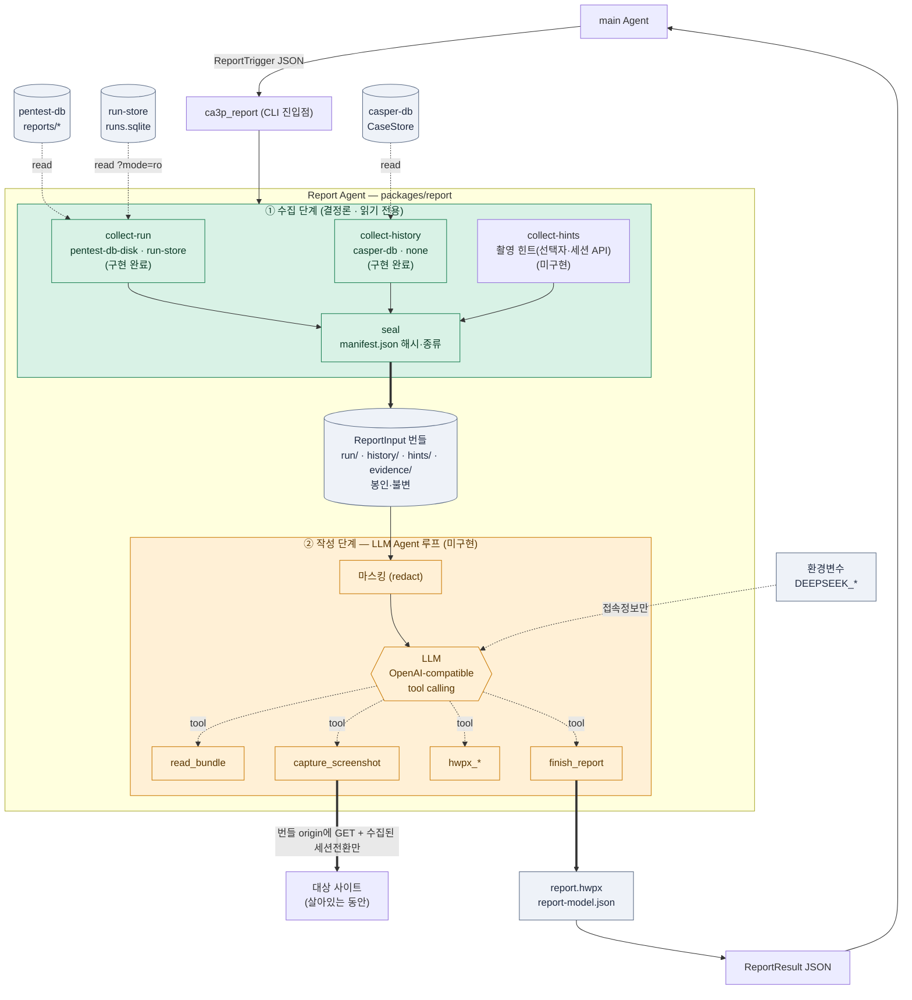

<!-- 생성: 2026-10-20 · 근거: packages/report/PLAN.md (origin/develop 기준) -->

# Report Agent — 모듈 설계 현황

main Agent가 트리거하면, 기존 모듈들의 실행 결과를 **읽기 전용으로 수집**하고 대상을 **직접 촬영**해,
LLM Agent가 도구를 호출하며 **HWPX 보고서**를 작성하는 모듈이다.
보고서는 무엇보다 **① 어떤 취약점 ② 공격 대상 ③ 실제 exploit 여부**를 담는다.

- 위치: `packages/report/` (브랜치 `woohyun212/report-module`, `origin/develop` 기준)
- 범위: 이 모듈 안에서만 작업하고 커밋까지. 통합 관리(manifest, CI, docker-compose)는 별도 담당.

## 1. 아키텍처 개요 (mermaid)

> 초록 = 구현 완료, 주황 = 미구현. 굵은 실선 = 데이터 흐름, 점선 = 읽기/도구 호출.

## 2. 계층과 책임

| 계층 | 책임 | 환경 접근 | 상태 |
|---|---|---|---|
| 수집기 `collect/` | 트리거가 지정한 원천을 읽기 전용으로 읽어 번들에 모음. 촬영 힌트도 찾아 둠 | 지정된 원천만 | ✅ run·history 완료 / hints 미구현 |
| seal `bundle.py` | 파일 해시·출처를 manifest로 봉인. 위치는 기록 안 함 | 출력 위치만 | ✅ 구현 완료 |
| 코어/LLM 루프 `llm/` | 번들을 마스킹해 LLM에 전달, 도구 호출 루프, 검증 | LLM 엔드포인트(환경변수) | ⬜ 미구현 |
| 도구 `llm/tools.py` | `read_bundle`·`capture_screenshot`·`hwpx_*`·`finish_report`. 각 도구가 자체 제약 강제 | capture만 번들 origin | ⬜ 미구현 |
| HWPX 작성 `hwpx/` | python-hwpx로 문서 작성. 텍스트 노드 삽입(이스케이프) | 없음 | ⬜ 미구현 |
| 스크린샷 도구 `capture/` (Node) | 샌드박스 브라우저로 촬영. LLM이 선택자·세션을 넘김 | 번들 loopback origin | ⬜ 미구현 |
| 프로필 `profiles/` | 취약점별 LLM 작성 힌트 + 검증 항목. 사이트 어댑터 없음 | 없음 | ⬜ 미구현 |

## 3. 입력 · 출력 계약

| | 형식 | 핵심 필드 |
|---|---|---|
| 입력 | `ReportTrigger` JSON | `runId`, `sources.run{kind,location}`, `sources.history`, `output.dir`, (선택)`capture.targetUrl` |
| 내부 | ReportInput 번들 (봉인·불변) | `manifest.json`, `run/report.json`, `run/events.json`, `history/casper.json`, `hints/capture.json`, `evidence/*`(작성 단계) |
| 출력 | `report.hwpx` + `ReportResult` JSON | `ok`, `files[]`, `summary{vulnerability,target,exploit}`, `sections`, `error` |

**결과 원천별 수집 방식(구현 완료)**

| kind | 읽기 방법 | 비고 |
|---|---|---|
| `pentest-db-disk` | `readRun` 규약(`sha256(runId)` 디렉터리). 모든 레벨에서 심링크 거부 | 파일당 5MB 상한 |
| `run-store` | SQLite `?mode=ro`. 승인된 pentest-db append와 legacy-import 이벤트만 | WAL 미체크포인트 쓰기도 읽음 |
| `casper-db` | `CaseStore.get_version`/`get`/`list_checks`. 대조 사례는 `loop.history`에서 | DB 없으면 `unavailable`, 생성 안 함 |

## 4. 불변 원칙

1. **환경 정보 무보유** — 경로·포트·대상 URL을 하드코딩/추측하지 않음. 모두 트리거로 받음. 예외는 LLM 접속 환경변수(`DEEPSEEK_*`) 하나.
2. **읽기 전용** — 원천(pentest-db, run-store, casper-db)에 쓰지 않음. 쓰는 곳은 출력 위치뿐.
3. **판정 안 함** — exploit 여부와 CVSS는 LLM이 보고서에 적음. 코드 강제·재계산 없음. 사실성은 프롬프트 지침과 LLM 품질에 의존(한계).
4. **도구가 위험 행동 차단** — 대상 origin 고정, 쓰기 요청 차단, 번들 밖 읽기 차단, 원시 XML 삽입 차단. LLM이 속아도 범위 제한.
5. **마스킹** — 쿠키·`Set-Cookie`·API 키·chain-of-thought는 LLM 입력·로그·출력 어디에도 안 남김.
6. **LLM 실패 = 실패 전달** — 템플릿 대체 없이 `LLM_FAILED`(exit 8)로 main Agent에 전달.

## 5. 마일스톤 현황

| | 단계 | 상태 |
|---|---|---|
| M1 | 수집기 + seal (CLI `collect`) | ✅ 완료 (테스트 55) |
| M2 | python-hwpx 스파이크 | ⬜ 다음 |
| M3 | HWPX 작성기 | ⬜ |
| M4 | 스크린샷 도구 (Node 샌드박스) | ⬜ |
| M5 | LLM 도구 계층 | ⬜ |
| M6 | 마스킹 | ⬜ |
| M7 | LLM 루프 + 클라이언트 | ⬜ |
| M8 | 진입점 `run` + stored_xss 프로필 | ⬜ |
| M9 | generic·bola 프로필 | ⬜ |
| M10 | 라이브 LLM 점검 (opt-in) | ⬜ |
| M11 | 연동 요청·문서·검증 | ⬜ |

## 6. 결정 반영 현황 (PLAN §7)

- **Q11** 종결 — 사이트 어댑터와 `target.application` 식별 제거. 촬영을 LLM이 직접 하므로 불필요
- **Q4** 종결 — 촬영에 필요한 정보는 수집기가 `hints/capture.json`에 담고, 없으면 LLM이 페이지에서 찾음
- **Q1/Q5** 종결 — 호출 방식·시점을 우리가 설계. finalize 직후 CLI를 `ReportTrigger`로 호출
- **Q13** 종결 — 이미지는 LLM이 필요에 따라 PNG로 촬영, 보고서 본문에 해시 미표기(manifest에만)
- **Q7** 종결 — HWPX 목차 확정(§2.7). 기관 양식은 추후 반영
- **Q8** 종결 — run 1건 = 보고서 1부. 월간/다건 집계 없음
- **Q12** 종결 — 심각도는 LLM이 CVSS 3.1로 산출(상류 severity 병기). 재계산·검증 없음: LLM이 쓴 값을 그대로 둠

남은 사용자 확인: 표지 기관 양식·로고 유무(Q7 세부)
