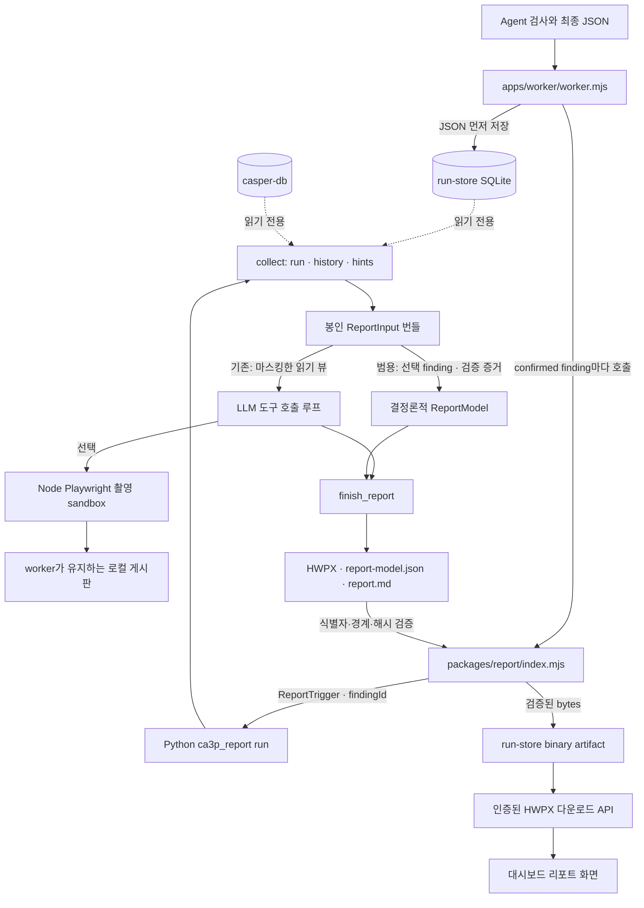

# Report Agent — 현재 구현과 플랫폼 연동

기존 검사 결과를 읽기 전용으로 수집해 HWPX 보고서를 작성한다. 범용 검사는 확정 finding마다
결정론적 보고서 한 개를 만들고, 기존 단일 취약점 검사는 LLM 도구 호출 경로를 사용한다.
수집·촬영·작성·HWPX 렌더링과 worker/API/dashboard 연동이 구현되어 있다.
설계 결정의 이력은 [PLAN.md](PLAN.md)에 보존한다.

## 실행 흐름

worker는 실제 실습의 완료·실패 보고서를 저장한 뒤 문서 생성을 시작한다. 범용 검사는
`confirmed` finding을 순회하고 나머지 판정에는 문서를 만들지 않는다. 생성 중에는 job lease와
heartbeat, 로컬 게시판을 유지하고 상태를 발행한다. 생성이 끝나거나 취소되면 `finally`에서 runtime을
닫는다. 문서 생성 실패는 검사의 finding이나 완료·실패 결과를 변경하지 않는다.
코어 fixture와 중지된 실행은 생성을 건너뛴다. 기존 단일 검사에 보고서용 API 설정이 없으면
`unavailable`로 표시한다.

## 계층과 책임

| 경로 | 구현된 책임 |
| --- | --- |
| `apps/worker/worker.mjs` | 최종 검사 JSON 저장, 자동 생성 호출, 상태 발행, binary artifact 저장, 게시판 수명 관리 |
| `packages/report/index.mjs` | 범용 finding 선택 검증, 기존 DeepSeek 설정 해석, Python 실행, 취소·시간·출력 제한, 산출물 검증 |
| `py/src/ca3p_report/trigger.py` | run ID·선택 finding ID·원천 종류·절대 경로 검증, 원천과 출력 위치의 겹침 거부 |
| `py/src/ca3p_report/collect/` | run·과거 사례·촬영 힌트 수집, 범용 확정 finding과 현재 검증 증거 선택, SHA-256 manifest와 번들 봉인 |
| `py/src/ca3p_report/general_model.py` | 선택한 확정 finding 한 건을 근거 기반 ReportModel로 작성. 없는 CWE·CVSS·재현 자료·조치 방안은 비움 |
| `py/src/ca3p_report/llm/` | OpenAI-compatible 클라이언트, 도구 호출 루프, 읽기 뷰와 출력 모델 마스킹 |
| `py/src/ca3p_report/profiles/` | `stored_xss`, `bola`, 미등록 유형용 `generic` 작성 힌트·검사 레이블 |
| `capture/` | loopback origin에 고정된 선택자·전체 페이지·viewport PNG 촬영 |
| `py/src/ca3p_report/hwpx/` | 파일명 정규화, 고정 목차·표·이미지·실패-run 변형, HWPX·Markdown 렌더링 |
| `packages/run-store/index.mjs` | `hwpx-report` binary artifact의 bytes·해시·크기·파일명·선택 finding ID 보관 |
| `apps/api/server.mjs` | 실행과 artifact의 연결·무결성 검사 후 인증된 사용자에게 다운로드 제공 |
| `agent-dashboard/dist/` | 문서 상태·과금 안내 표시, 준비된 실행의 HWPX 다운로드 |

## 입력과 출력

Python CLI는 파일 또는 stdin의 `ReportTrigger` JSON을 받는다. 필수 입력은
`schemaVersion: "report-trigger-1.0"`, `runId`, `sources.run{kind,location}`, `output.dir`이다.
범용 검사에서는 `options.findingId`도 필수이며 기존 단일 검사에서는 허용하지 않는다.
`sources.history`는 생략하면 `none`이다. 촬영 origin은 수집한 최종 보고서의 `target.origin`에서 얻고,
세션 전환 정보는 parser 관찰에서 만든 `hints/capture.json`에서 얻는다.

| 명령 | 결과와 호출 범위 |
| --- | --- |
| `python -m ca3p_report collect --trigger ...` | LLM·대상 접속 없이 `bundle/`만 생성 |
| `python -m ca3p_report run --trigger ...` | 새 번들 수집 후 범용 finding 결정론적 작성 또는 기존 단일 검사 LLM 작성, 문서 생성 |

`run`은 기존 번들에서 재개하는 명령이 아니다. 같은 출력 위치에 `collect` 후 `run`을 호출하면
이미 봉인된 번들이 있어 거부된다. 플랫폼 runner는 실행별·시도별 별도 출력 위치를 만든다.

| 수집 원천 | 읽는 내용과 경계 |
| --- | --- |
| `pentest-db-disk` | `sha256(runId)` 아래 최종 보고서와 정렬된 이벤트. run 하위 심링크·특수 파일 거부, 파일당 5MB 제한 |
| `run-store` | SQLite `mode=ro`, `runs.state_json`의 report, sequence 순서의 승인된 append·legacy-import 이벤트. 범용 검증 이벤트는 최종 state의 Agent 이벤트에서 수집 |
| `casper-db` | `loop.history`가 참조한 당시 revision snapshot·현재 revision·재점검 checks. 없거나 읽지 못하면 `unavailable` |

원천 DB의 내용은 변경하지 않는다. SQLite WAL을 읽을 때 빈 `-wal`/`-shm` 파일은 생길 수 있다.
번들에는 `manifest.json`, `run/report.json`, `run/events.json`, `history/casper.json`,
`hints/capture.json`을 저장한다. 범용 선택에서는 `run/selection.json`도 봉인한다. 이 파일에는 선택한
원본 finding ID, confirmed verify 이벤트와 일치하는 현재 probe 증거 ID를 기록한다. 수집분의 해시와 수집기 상태를 봉인하고 원천 경로는 manifest에 기록하지
않는다. 선택적인 사진은 작성 단계에서 `bundle/evidence/images/`에 추가한다.

작성 결과는 `report/<이름>.hwpx`, `report/report-model.json`, `report/report.md`와 한 줄의
`report-result-1.0` JSON이다. 범용 결과는 `findingId`, ReportModel은 `sourceFindingId`와 검증 증거 ID를 포함한다.
runner는 CLI 응답과 ReportModel의 run ID·finding ID, 파일명·출력 경계,
파일 크기·SHA-256·ZIP signature를 검사하고 HWPX bytes를 별도 artifact로 보관한다.

## 플랫폼 상태와 다운로드

`run.report`는 원래 검사 JSON이다. 범용 검사 문서 상태는 `run.reportDocuments.items[]`에 finding별로,
기존 단일 검사 문서 상태는 `run.reportDocument`에 저장한다.

| 상태 | 의미 |
| --- | --- |
| `generating` | 문서 작성 중 |
| `ready` | `artifactId`, `filename`이 있는 다운로드 가능 상태 |
| `failed` | 모델·실행 환경·시간 제한·산출물 검사 등의 실패 또는 문서 생성 취소 |
| `unavailable` | 보고서용 DeepSeek API 설정 없음·오류 |
| `skipped` | fixture·중지·최종 검사 보고서 부재로 생성 생략 |

상태에는 안전한 메시지·오류 코드·시각을 담으며 로컬 출력 경로나 API 키를 담지 않는다.
범용 문서는 `GET /api/runs/:runId/reports/:artifactId.hwpx`, 기존 단일 문서는
`GET /api/runs/:runId/report.hwpx`에서 다운로드한다. 로그인한 viewer도 이용할 수 있다. API는 해당
실행의 준비된 `hwpx-report` artifact와 범용 finding 연결만 허용하고 bytes의 크기·해시를 다시 확인한다.
`Content-Disposition`의 UTF-8 파일명으로 한국어 이름을 전달하며, DB를 다시 열어도 다운로드할 수 있다.

## 실행·보호 경계와 한계

- 범용 선택 모드는 DeepSeek 설정이나 호출 없이 확정 finding의 현재 probe 검증 증거로 문서를 만든다.
  배경 증거는 확정 근거로 표시하지 않는다. 없는 CWE·CVSS·재현 요청·응답·조치 방안은 추정하지 않는다.
  기존 단일 검사에서는 Node runner가 `agent/src/deepseek-config.js`로 설정을 해석해 Python에 전달한다.
  이 경로의 직접 CLI 실행에는 `DEEPSEEK_BASE_URL`, `DEEPSEEK_API_KEY`, `DEEPSEEK_MODEL`이 필요하다.
- 플랫폼 runner는 기본 180초, 합산 stdout/stderr 1MB, HWPX 20MB 제한과 AbortSignal 취소를 적용한다.
  Python 실행 파일은 `CA3P_REPORT_PYTHON`, `CASPER_DB_PYTHON`, OS 기본 Python 순으로 선택한다.
  Python의 개별 모델 요청 제한은 300초이며 직접 실행한 도구 호출 루프에는 반복 상한이 없다.
- 촬영은 정확한 `http://127.0.0.1:<port>`에 고정한다. GET/HEAD 외에는 수집된 세션 전환 한 번만
  허용하고 외부 origin·일반 쓰기·WebSocket·서비스 워커·다운로드를 차단한다. 사진은 선택적인 보조 자료다.
- `read_bundle`은 원본 봉인 bytes를 유지하면서 JSON 구조·텍스트를 마스킹한 뷰를 모델에 보낸다.
  `finish_report`도 출력 모델을 마스킹한다. 모델의 원시 XML 삽입 대신 text-node API를 사용한다.
- 취약점 판정·CVSS의 의미적 정확성은 검증하지 않는다. HWPX 구조 검사·식별자·파일 해시 검사는
  보고서 서술의 사실성을 보장하지 않는다. 모델 실패 시 템플릿으로 대체하지 않으며 사람이 초안을 최종 검토한다.
- 범용 검사는 확정 finding당 보고서 한 개, 기존 단일 검사는 run당 한 개다.
  월간·다건 집계와 기관 표지·로고 양식은 별도 후속 작업이다.

## 검증 범위

`report`는 integration manifest의 활성 모듈이며 CI는 Node runner·capture 테스트와 Python 테스트를
실행한다. 가짜 모델을 사용해 수집·경로·마스킹·렌더링·취소·실패·게시판 수명·다운로드를 검사한다.
`tests/integration.test.mjs`는 loopback 가짜 HTTP 모델 2턴으로 실제 Python CLI와 HWPX writer를 실행하고,
ZIP·XML·한국어·escaping, binary 저장, viewer 다운로드, DB 재오픈 후 동일 bytes를 검증한다.
capture sandbox의 요청 차단은 별도 브라우저 테스트로 확인한다. 유료 live LLM의 보고서 품질을 검증한
결과는 이 문서에 포함하지 않는다.
